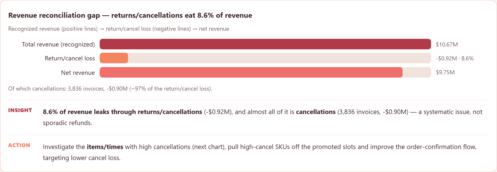
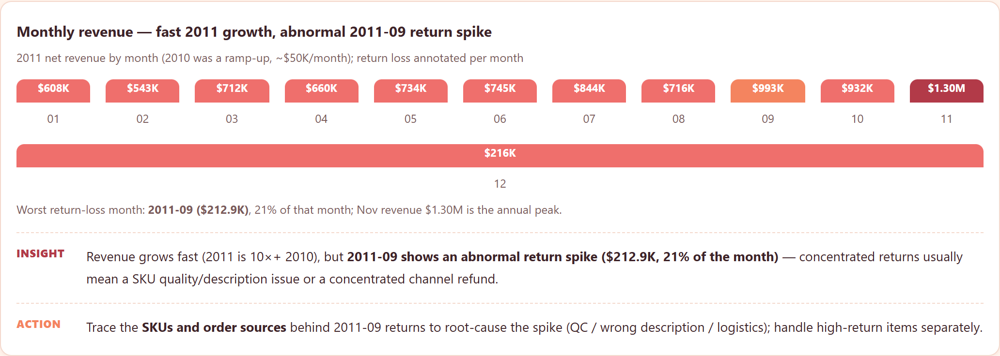
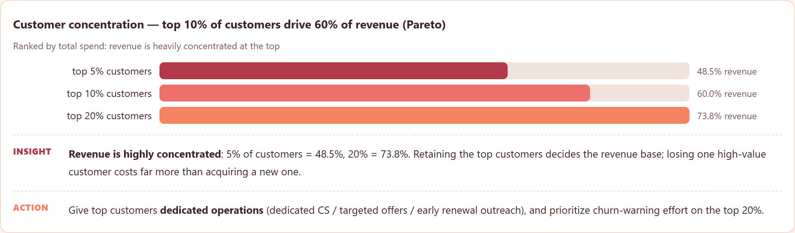
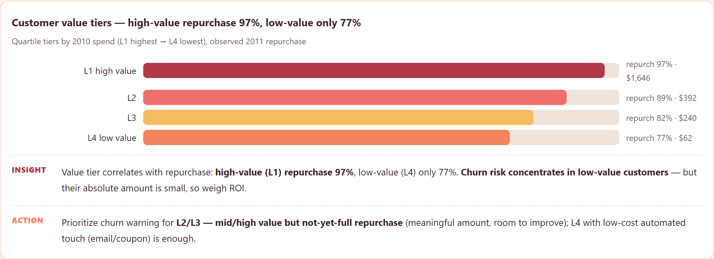

# Online Retail — Revenue Reconciliation & Customer Value

**The business problem.** An online retailer bills revenue, then watches some of
it leak back through cancellations and returns. Nobody has quantified the leak,
and nobody knows which customers will stay and spend again versus churn. This
repo answers both on **real** UCI Online Retail transaction data (541,909 lines,
UK retailer, 2010–2011) — not synthetic.

## What it does

- Cleans a messy real export: **24.9% of transactions have no CustomerID**,
  negative quantities/prices mark returns/refunds, and `C`-prefixed invoices are
  cancellations. Builds line / invoice / customer (RFM) level tables.
- **Revenue reconciliation**: gross (should-confirm) revenue **$10.67M** vs net
  **$9.75M** — returns/cancellations leak **-$0.92M (8.6%)**, and ~97% of that
  leak is **cancellations** (3,836 invoices, -$0.90M). A concentrated return
  spike in **2011-09** ($212.9K, 21% of that month) is flagged for root-causing.
- **Customer value**: top 10% of customers drive **60%** of revenue (Pareto);
  high-value tier repurchases at 97% vs 77% for low-value.
- **Models (customer-level, temporal split — features 2010, labels 2011, no
  leakage)**: repurchase classifier **GBM AUC 0.63 / PR-AUC 0.925**, CLV
  regression **linear R² 0.32**.

## Honest notes (what I did NOT overclaim)

- Only **948 customers** had purchases in the feature period (2010). Repurchase
  is heavily imbalanced (86.5% repurchase), so classifier AUC ~0.63 is *medium*
  signal — used to **rank** churn risk, not as a precise amount forecast.
- CLV regression R² 0.32 explains part of the variance; tree regressors
  overfit on this small sample (linear wins).
- **No deep learning used**: 948 samples, plain tabular, no sequence; trees /
  linear already fit and stay explainable (feature importance). DL gains little
  here and hurts the "customer-ops must be explainable" narrative — same rule as
  my other projects.
- Line-level payment/refund reconciliation needs bank/platform statements;
  this project quantifies the transaction-layer leak only — listed as next step.

## Charts






> Full interactive report: open `index.html` (English) or `index.zh-CN.html` (Chinese) after cloning — GitHub doesn't render HTML.

## Layout

```
scripts/
  clean_data.py      # line/invoice/customer(RFM) tables + temporal split
  analyze.py         # revenue reconciliation, monthly, concentration, RFM tiers
  ml_analysis.py     # repurchase classifier + CLV regression (logistic/linear/RF/GBM)
tests/
  test_cleaning.py   # shape, return/cancel counts, no temporal leakage
  test_report_numbers.py  # recompute metrics from parquet, assert HTML matches
index.html        # English interactive report
index.zh-CN.html  # Chinese report, every chart has Insight + Action
```

## Run it

```bash
python -m venv .venv && .venv\Scripts\activate
pip install -r requirements.txt
python scripts/clean_data.py
python scripts/analyze.py
python scripts/ml_analysis.py
pytest tests/ -q
```

## Key verified numbers

- 541,909 lines / 25,900 invoices / 4,372 customers; 24.9% no CustomerID
- Gross $10.67M → net $9.75M; leak -$0.92M (8.6%), ~97% cancellations
- Top 5/10/20% customers → 48.5% / 60% / 73.8% of revenue
- Repurchase 86.5%; churn 13.5%; avg future revenue $4,066
- Models: repurchase GBM AUC 0.627 / PR 0.925; CLV linear R² 0.318

## Data source

The raw file lives in `data/raw/` (excluded from git — after cloning, download it yourself).

| File | What it is | Kaggle download |
|---|---|---|
| `Online_Retail.csv` | UK retailer transactions, 541,909 lines, 2010–2011 (UCI) | `kaggle datasets download -d tunguz/online-retail -p data/raw --unzip` |

Kaggle page: https://www.kaggle.com/datasets/tunguz/online-retail

```bash
pip install kaggle
kaggle datasets download -d tunguz/online-retail -p data/raw --unzip
# requires a kaggle.json / KAGGLE_USERNAME + KAGGLE_KEY
```

— Jiawei Wang
