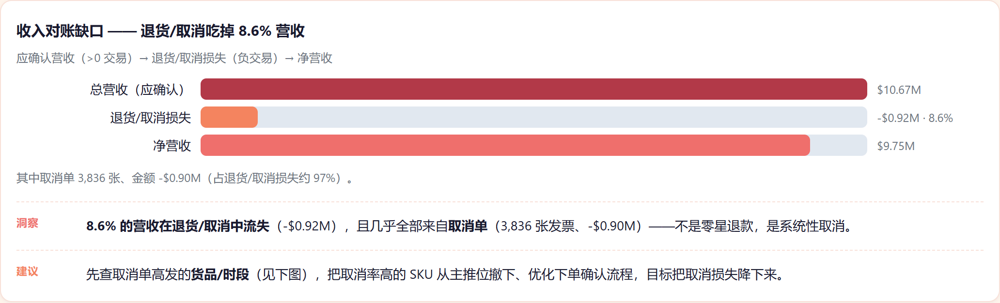
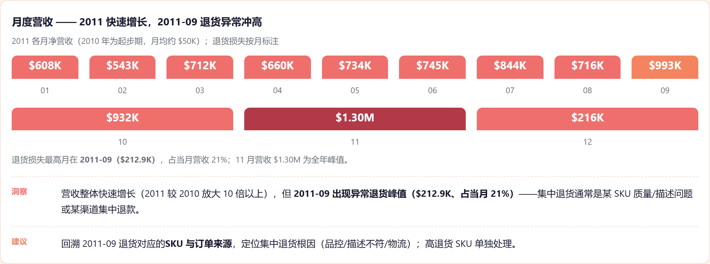
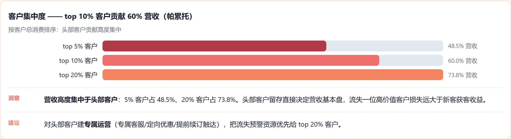
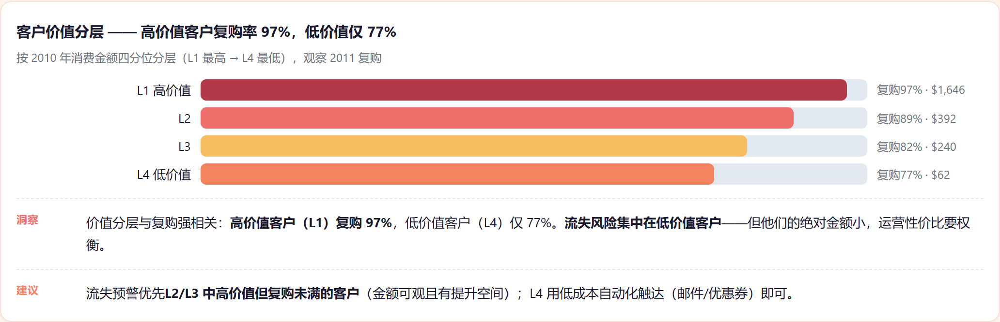

# 电商收入对账与客户价值分析（Online Retail Revenue Reconciliation & Customer Value）

> 项目目标：量化电商收入通过取消/退货"漏走"的金额，并识别哪些客户会回购、价值几何，让运营把钱和精力投在留住高价值客户上。
> 数据：真实 UCI Online Retail 交易数据（541,909 行，英国零售商，2010–2011），非合成。

## 一、业务背景与目的

线上零售商确认收入后，部分会通过**取消和退货**漏回。没人量化过这个漏损，也没人知道哪些客户会留下再买、哪些会流失。本项目在真实交易数据上同时回答这两个问题。

## 二、数据清洗与预处理

- 清洗脏乱真实导出：**24.9% 的交易没有 CustomerID**；负数量/负价格标记退货/退款；`C` 前缀发票是取消单。构建行级 / 发票级 / 客户级（RFM）三层表。
- **时间切分（无泄漏）**：特征期用 2010、标签期用 2011，客户级建模不会用到未来信息。

## 三、关键指标

| 指标 | 数值 |
|---|---|
| 规模 | 541,909 行 / 25,900 张发票 / 4,372 名客户；24.9% 无 CustomerID |
| 收入对账 | 毛利（应确认）**$10.67M** vs 净 **$9.75M** |
| 漏损 | **-$0.92M（8.6%）**，其中 **~97% 是取消单**（3,836 张发票，-$0.90M） |
| 异常点 | **2011-09 取消/退货激增**（$212.9K，占当月 21%）——需根因排查 |
| 客户价值 | top 10% 客户贡献 **60%** 收入（Pareto）；高价值层复购 97% vs 低价值层 77% |

## 四、建模

在**客户级、时间切分、无泄漏**的框架下：
- **复购分类器**：GBM **AUC 0.63 / PR-AUC 0.925**——用于给流失风险排序，而不是精确金额预测。
- **CLV 回归**：线性 **R² 0.32**（树模型在 948 个样本上过拟合，线性胜出）。

**为什么不用深度学习**：特征期只有 948 名客户、普通表格、无序列；树/线性已够且可解释（特征重要性）。DL 增益极小、还伤害"客户运营必须可解释"的叙事——与其他项目同一规则。

## 五、图表






> 完整交互版报告：`报告/电商收入对账与客户价值分析.html`——GitHub 不渲染仓库内 HTML，clone 后本地打开。

## 六、数据来源

原始数据在项目内 `data/raw/`（不入 git——clone 后请自行下载）。

| 文件 | 说明 | Kaggle 下载 |
|---|---|---|
| `Online_Retail.csv` | 英国零售商交易，541,909 行，2010–2011（UCI） | `kaggle datasets download -d tunguz/online-retail -p data/raw --unzip` |

Kaggle 页面：https://www.kaggle.com/datasets/tunguz/online-retail

```bash
pip install kaggle
kaggle datasets download -d tunguz/online-retail -p data/raw --unzip
# 需要 kaggle.json / KAGGLE_USERNAME + KAGGLE_KEY 认证
```

## 七、运行方式

```bash
pip install -r requirements.txt
python scripts/clean_data.py    # 行/发票/客户(RFM)表 + 时间切分
python scripts/analyze.py       # 收入对账、月度、集中度、RFM 分层
python scripts/ml_analysis.py   # 复购分类器 + CLV 回归（logistic/linear/RF/GBM）
pytest tests/ -q
```

## 八、诚实边界

- 复购严重不平衡（86.5% 复购），AUC 0.63 是**中等信号**，用于排序流失风险、不作精确金额预测。
- 行级支付/退款对账需要银行/平台流水；本项目只量化交易层漏损——列为下一步。

— Jiawei Wang
